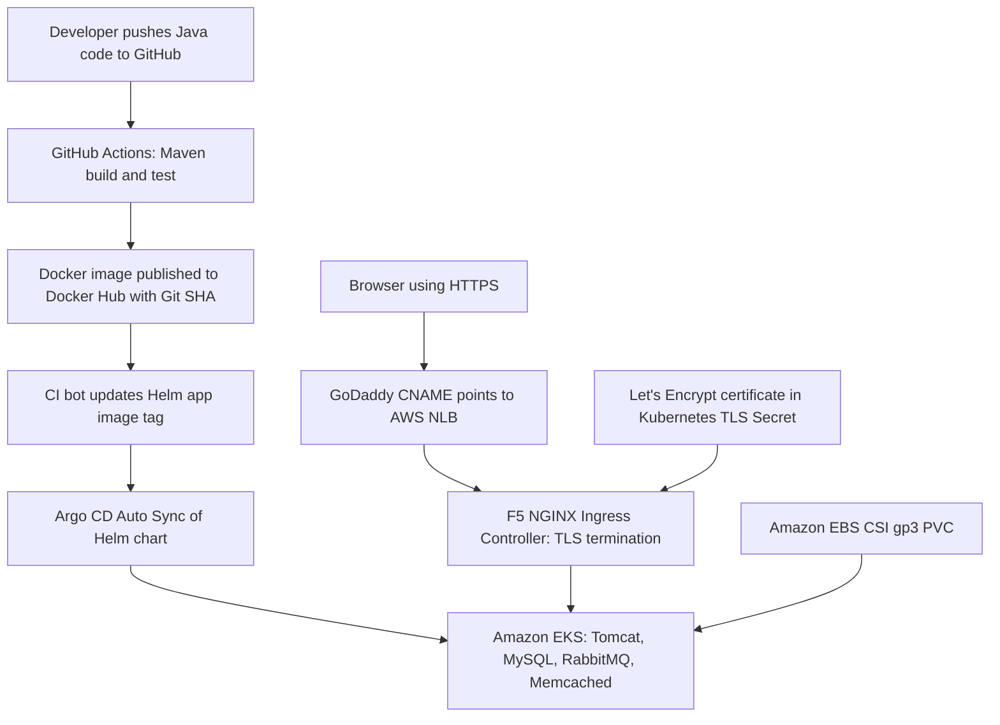

[VProfile_EKS_GitOps_Final_README.md](https://github.com/user-attachments/files/34857292/VProfile_EKS_GitOps_Final_README.md)
# VProfile — Amazon EKS CI/CD and GitOps Implementation

**Interview / academic DevOps project** · **AWS region:** `ap-southeast-2` (Sydney) · **Kubernetes:** Amazon EKS · **GitOps:** Argo CD · **HTTPS:** Let's Encrypt

A fully documented, evidence-based implementation of a Java/Tomcat VProfile application on AWS. The repository documentation demonstrates infrastructure provisioning, persistent storage, public traffic routing, Maven/Docker CI, automatic Argo CD deployment, and trusted HTTPS access. It follows the screenshot-led, step-by-step structure of the Jenkins CI/CD repository example.

**Jump to:** [Project flow](#project-flow) · [All phases](#project-implementation--clickable-chapters) · [Screenshot evidence](#screenshots--real-implementation-proof) · [File index](docs/FILE_INDEX.md) · [Adding documentation to GitHub](#adding-this-documentation-to-your-existing-repository)

## Project flow



The **administration EC2** provisions EKS via `eksctl` and manages Kubernetes. The **public AWS Network Load Balancer** forwards TCP 443 to **F5 NGINX Ingress**, which serves the Let's Encrypt certificate from the `vprofile-tls` Secret; the application itself runs on port 8080 behind `vproapp-service`.

## Project implementation — clickable chapters

| Phase | Click to read full step-by-step guide | Screenshots | Commands / outputs |
| :--- | :--- | :--- | :--- |
| **01** | [EC2 Administration and Bootstrap](docs/ec2-administration/README.md) — EC2, IAM instance profile, User Data and verified CLI tools | [📷 View all screenshots](docs/ec2-administration/screenshots/README.md) | [📋 Browse outputs](docs/ec2-administration/outputs/README.md) |
| **02** | [Amazon EKS Cluster Provisioning](docs/eks-cluster/README.md) — EKS 1.36, managed node group and CloudFormation | [📷 View all screenshots](docs/eks-cluster/screenshots/README.md) | [📋 Browse outputs](docs/eks-cluster/outputs/README.md) |
| **03** | [EBS CSI and Persistent Storage](docs/persistent-storage/README.md) — gp3 EBS volume, EBS CSI add-on and Bound MySQL PVC | [📷 View all screenshots](docs/persistent-storage/screenshots/README.md) | [📋 Browse outputs](docs/persistent-storage/outputs/README.md) |
| **04** | [AWS NLB and NGINX Ingress](docs/load-balancing/README.md) — AWS Load Balancer Controller, NGINX and healthy NLB targets | [📷 View all screenshots](docs/load-balancing/screenshots/README.md) | [📋 Browse outputs](docs/load-balancing/outputs/README.md) |
| **05** | [Docker and GitHub Actions CI](docs/ci-cd/README.md) — Maven Build/Test, Docker Hub SHA images and Helm GitOps commit | [📷 View all screenshots](docs/ci-cd/screenshots/README.md) | [📋 Browse outputs](docs/ci-cd/outputs/README.md) |
| **06** | [Argo CD Automated GitOps](docs/argo-cd/README.md) — Argo CD auto-sync, health and deployed site change | [📷 View all screenshots](argocd/screenshots/README.md) | [📋 Browse outputs](docs/argo-cd/outputs/README.md) |
| **07** | [Let's Encrypt HTTPS and TLS](docs/https-tls/README.md) — GoDaddy DNS-01, Kubernetes TLS Secret, HTTPS and 301 redirect | [📷 View all screenshots](docs/https-tls/screenshots/README.md) | [📋 Browse outputs](docs/https-tls/outputs/README.md) |

**Browse by folder:** [All technical documentation](docs/README.md) · [All screenshot evidence](EVIDENCE_GALLERY.md) · [Every file in this ZIP](docs/FILE_INDEX.md)

## Screenshots — real implementation proof

The previews below link to the original images. Open each chapter or its gallery to see **every screenshot at full resolution**.

### Phase 01 — [EC2 Administration and Bootstrap](docs/ec2-administration/README.md)

[](docs/ec2-administration/screenshots/ec2-instance-summary.png)

[See all Phase 01 screenshots](docs/ec2-administration/screenshots/README.md) · [Read detailed implementation](docs/ec2-administration/README.md)

### Phase 02 — [Amazon EKS Cluster Provisioning](docs/eks-cluster/README.md)

[](docs/eks-cluster/screenshots/eks-cluster-overview.png)

[See all Phase 02 screenshots](docs/eks-cluster/screenshots/README.md) · [Read detailed implementation](docs/eks-cluster/README.md)

### Phase 03 — [EBS CSI and Persistent Storage](docs/persistent-storage/README.md)

[](docs/persistent-storage/screenshots/eks-ebs-csi-and-pod-identity-addons.png)

[See all Phase 03 screenshots](docs/persistent-storage/screenshots/README.md) · [Read detailed implementation](docs/persistent-storage/README.md)

### Phase 04 — [AWS NLB and NGINX Ingress](docs/load-balancing/README.md)

[](docs/load-balancing/screenshots/aws-nlb-listeners-target-map.png)

[See all Phase 04 screenshots](docs/load-balancing/screenshots/README.md) · [Read detailed implementation](docs/load-balancing/README.md)

### Phase 05 — [Docker and GitHub Actions CI](docs/ci-cd/README.md)

[](docs/ci-cd/screenshots/github-actions-four-stage-success.png)

[See all Phase 05 screenshots](docs/ci-cd/screenshots/README.md) · [Read detailed implementation](docs/ci-cd/README.md)

### Phase 06 — [Argo CD Automated GitOps](docs/argo-cd/README.md)

[](argocd/screenshots/argocd-resource-tree.png)

[See all Phase 06 screenshots](argocd/screenshots/README.md) · [Read detailed implementation](docs/argo-cd/README.md)

### Phase 07 — [Let's Encrypt HTTPS and TLS](docs/https-tls/README.md)

[](docs/https-tls/screenshots/browser-le-certificate-redacted.png)

[See all Phase 07 screenshots](docs/https-tls/screenshots/README.md) · [Read detailed implementation](docs/https-tls/README.md)

## Repository directory map

The ZIP mirrors the folders of your working VProfile GitHub repository while adding only documentation and evidence. Links below open their index READMEs:

```text
README.md                           <-- Main GitHub landing page and phase index
EVIDENCE_GALLERY.md                 <-- Full linked screenshot index
docs/
  README.md                         <-- Chapter navigation
  ec2-administration/
    README.md                       <-- Complete phase guide
    screenshots/README.md           <-- Embedded, full-resolution evidence
    outputs/README.md               <-- Terminal outputs and scripts
  eks-cluster/
    README.md                       <-- Complete phase guide
    screenshots/README.md           <-- Embedded, full-resolution evidence
    outputs/README.md               <-- Terminal outputs and scripts
  persistent-storage/
    README.md                       <-- Complete phase guide
    screenshots/README.md           <-- Embedded, full-resolution evidence
    outputs/README.md               <-- Terminal outputs and scripts
  load-balancing/
    README.md                       <-- Complete phase guide
    screenshots/README.md           <-- Embedded, full-resolution evidence
    outputs/README.md               <-- Terminal outputs and scripts
  ci-cd/
    README.md                       <-- Complete phase guide
    screenshots/README.md           <-- Embedded, full-resolution evidence
    outputs/README.md               <-- Terminal outputs and scripts
  argo-cd/
    README.md                       <-- Complete phase guide
    outputs/README.md               <-- Terminal outputs and scripts
  https-tls/
    README.md                       <-- Complete phase guide
    screenshots/README.md           <-- Embedded, full-resolution evidence
    outputs/README.md               <-- Terminal outputs and scripts
  FILE_INDEX.md                     <-- Every bundled file
argocd/screenshots/README.md        <-- Phase 6 GitOps screenshots
bootstrap/README.md                <-- Existing PV/PVC manifest pointers
eks/README.md                      <-- Existing EKS cluster manifest pointers
Docker-files/README.md             <-- Existing Dockerfiles pointers
.github/workflows/README.md        <-- Existing CI workflow pointer
tools/verify_markdown_links.py     <-- Offline link checker
```

## Source code and configuration navigation

The following are links to **live source files in the existing GitHub repository**, not duplicates included in this documentation archive:

| Component | Source code |
| :--- | :--- |
| EKS eksctl cluster | [`eks/cluster.yaml`](https://github.com/Kizhakkekkara-Vishnu-Vijayan/vprofile-eks-gitops/blob/main/eks/cluster.yaml) |
| NGINX Helm values | [`eks/nginx-values.yaml`](https://github.com/Kizhakkekkara-Vishnu-Vijayan/vprofile-eks-gitops/blob/main/eks/nginx-values.yaml) |
| Helm values and Docker image tag | [`helm/vprofile-chart/values.yaml`](https://github.com/Kizhakkekkara-Vishnu-Vijayan/vprofile-eks-gitops/blob/main/helm/vprofile-chart/values.yaml) |
| Ingress TLS routing | [`helm/vprofile-chart/templates/appingress.yaml`](https://github.com/Kizhakkekkara-Vishnu-Vijayan/vprofile-eks-gitops/blob/main/helm/vprofile-chart/templates/appingress.yaml) |
| Argo CD Application | [`argocd/application.yaml`](https://github.com/Kizhakkekkara-Vishnu-Vijayan/vprofile-eks-gitops/blob/main/argocd/application.yaml) |
| GitHub Actions CI workflow | [`.github/workflows/ci.yaml`](https://github.com/Kizhakkekkara-Vishnu-Vijayan/vprofile-eks-gitops/blob/main/.github/workflows/ci.yaml) |
| App Dockerfile | [`Docker-files/app/Dockerfile`](https://github.com/Kizhakkekkara-Vishnu-Vijayan/vprofile-eks-gitops/blob/main/Docker-files/app/Dockerfile) |
| DB Dockerfile | [`Docker-files/db/Dockerfile`](https://github.com/Kizhakkekkara-Vishnu-Vijayan/vprofile-eks-gitops/blob/main/Docker-files/db/Dockerfile) |
| MySQL PVC | [`bootstrap/db-pvc.yaml`](https://github.com/Kizhakkekkara-Vishnu-Vijayan/vprofile-eks-gitops/blob/main/bootstrap/db-pvc.yaml) |
| StorageClass | [`bootstrap/storageclass.yaml`](https://github.com/Kizhakkekkara-Vishnu-Vijayan/vprofile-eks-gitops/blob/main/bootstrap/storageclass.yaml) |
| Maven project | [`pom.xml`](https://github.com/Kizhakkekkara-Vishnu-Vijayan/vprofile-eks-gitops/blob/main/pom.xml) |

## Observed acceptance results

| Verification | Evidence |
| :--- | :--- |
| EKS managed worker | Node ready and observed in AWS EKS screenshots |
| EBS persistent storage | `gp3` volume in use and MySQL PVC Bound |
| CI/CD | GitHub Actions Build, Test, Docker Push and Helm Update jobs succeeded |
| GitOps | Argo CD Application `vprofile`: Synced / Healthy, automated sync and selfHeal enabled |
| Application | Four workload pods observed Running with zero restarts in Phase 7 evidence |
| HTTPS | Let's Encrypt wildcard cert; TLS 1.3; certificate verification OK; HTTP 200 |
| HTTP redirect | HTTP 301 to HTTPS, handled by F5 NGINX |

For source observations, see [Phase 6](docs/argo-cd/README.md), [Phase 7](docs/https-tls/README.md) and their captured outputs. These are lab snapshots, not continuously monitored live-state claims.

## Adding this documentation to your existing repository

1. Download the ZIP and extract it **at the root** of `vprofile-eks-gitops` (where `helm/`, `eks/`, `.github/`, `Docker-files/`, and `argocd/` already exist).
2. Keep the existing implementation files. This ZIP contains **documentation, read-only verification scripts and sanitized evidence**; it must not replace your live Helm or Kubernetes configuration files.
3. Preview the root `README.md` in GitHub. Each phase link, screenshot preview, gallery, code pointer and file index should open from there.
4. Run `python3 tools/verify_markdown_links.py` locally and check for zero broken local links. The script does not verify online external URLs.
5. Review screenshots and terminal evidence for project-specific information before making the repository public. **Never commit a real TLS Secret YAML, private key, cloud keys or other credentials.**

**Maintenance notes:** the manual Certbot DNS-01 certificate expires on **12 February 2027** and is not automatically renewed. Phase 7 also identified the missing `Secure` attribute on `JSESSIONID`; see the security-hardening notes in the phase guide.

---

[Open all implementation chapters](docs/README.md) · [Complete evidence gallery](EVIDENCE_GALLERY.md) · [File-by-file hyperlinks](docs/FILE_INDEX.md) · [Documentation link report](LINK_VALIDATION.md)
